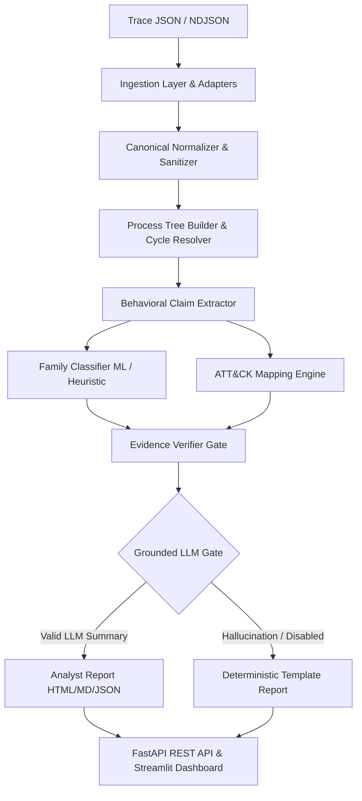

Listed directory MalTrace-LM
Listed directory src
Listed directory maltrace
Viewed README.md:1-206
Viewed HANDOFF.md:1-80
Ran command: `Get-ChildItem -Recurse -File | Select-Object FullName, Length | Format-Table -AutoSize`
Ran command: `Get-ChildItem -Recurse -File | ForEach-Object { $_.FullName.Replace('C:\Users\duddu\Downloads\MalTrace-LM\', '') }`
Ran command: `pytest -v`
Viewed schemas.py:1-150
Viewed schemas.py:151-321
Used tool: manage_task
Viewed loader.py:1-31
Viewed adapters.py:1-100
Used tool: manage_task
Viewed stream_parser.py:1-204
Used tool: manage_task
Viewed normalizer.py:1-100
Used tool: manage_task
Viewed renderer.py:1-181
Viewed selector.py:1-159
Viewed process_tree.py:1-165
Viewed catalog.json:1-124
Viewed mapper.py:1-52
Viewed catalog.py:1-100
Viewed family_classifier.py:1-113
Viewed trainer.py:1-100
Viewed validator.py:1-100
Viewed report_generator.py:1-100
Viewed grounding_gate.py:1-139
Viewed app.py:1-100
Viewed app.py:1-100
Viewed cli.py:1-120
Viewed cli.py:121-300
Viewed cli.py:301-602
Viewed model_baseline.md:1-67
Viewed evidence_verifier.md:1-70
Viewed generator.py:1-100
Viewed summarizer.py:1-149
Viewed Makefile:1-25
Viewed pyproject.toml:1-46
Viewed gold_fixtures.json:1-30

Here is the comprehensive analysis of the **MalTrace-LM** codebase, detailing what is currently implemented, the gaps and limitations that need implementation, and advanced feature ideas to expand the project.

---

## 🏛️ System Overview & Architecture

**MalTrace-LM** is a defensive execution trace analysis and MITRE ATT&CK mapping engine. It operates on structured Windows execution trace JSON logs, converts raw Win32/Native API events into normalized behavior claims, predicts malware family classifications with confidence bands, maps actions to MITRE ATT&CK techniques with verified evidence linkage, and produces analyst-ready reports with optional LLM enhancement.

---

## ✅ 1. What Has Been Implemented (Complete Module Breakdown)

The project currently has **76 unit and integration tests passing (100%)**.

### 1. Ingestion & Streaming Layer
- [`src/maltrace/ingestion/loader.py`](file:///c:/Users/duddu/Downloads/MalTrace-LM/src/maltrace/ingestion/loader.py): High-performance trace loader utilizing `orjson`.
- [`src/maltrace/ingestion/adapters.py`](file:///c:/Users/duddu/Downloads/MalTrace-LM/src/maltrace/ingestion/adapters.py): `ReportAdapter` supporting WinMET traces, Cuckoo/CAPE sandbox reports, and raw event lists. Handles missing fields and warns on unrecognized sections.
- [`src/maltrace/ingestion/stream_parser.py`](file:///c:/Users/duddu/Downloads/MalTrace-LM/src/maltrace/ingestion/stream_parser.py): Memory-bounded per-file streaming (`stream_parse_file`), NDJSON/JSONL parsing, SHA-256 calculation, and batch processing (`process_batch`) exporting to JSONL, Parquet, and run manifests.

### 2. Representation & Canonical Normalization Layer
- [`src/maltrace/representation/normalizer.py`](file:///c:/Users/duddu/Downloads/MalTrace-LM/src/maltrace/representation/normalizer.py): Normalizes Win32/Native APIs into 8 categories (`process`, `registry`, `file`, `network`, `service`, `memory`, `synchronization`, `other`). Scrubs usernames (`C:\Users\<USER>`), identifies registry persistence keys, categorizes network destinations (`loopback`, `private`, `public`), computes deterministic SHA-256 hashes, and collapses repeated consecutive events.
- [`src/maltrace/representation/renderer.py`](file:///c:/Users/duddu/Downloads/MalTrace-LM/src/maltrace/representation/renderer.py) & [`vocabulary.json`](file:///c:/Users/duddu/Downloads/MalTrace-LM/src/maltrace/representation/vocabulary.json): Translates normalized events into controlled natural language behavior statements across 12 categories, inserting neutral fallback placeholders for absent fields.
- [`src/maltrace/representation/anchors.py`](file:///c:/Users/duddu/Downloads/MalTrace-LM/src/maltrace/representation/anchors.py): Identifies high-value security anchor events (e.g., VSS deletion, credential theft, startup persistence, service modification, process injection).
- [`src/maltrace/representation/selector.py`](file:///c:/Users/duddu/Downloads/MalTrace-LM/src/maltrace/representation/selector.py): Context budget selectors (`DefaultBudgetSelector`, `FrontTruncationSelector`, `CategoryFrequencySelector`) ensuring mandatory security anchors and process representations fit within token/character limits.
- [`src/maltrace/representation/grouping.py`](file:///c:/Users/duddu/Downloads/MalTrace-LM/src/maltrace/representation/grouping.py) & [`exporter.py`](file:///c:/Users/duddu/Downloads/MalTrace-LM/src/maltrace/representation/exporter.py): Groups statements by process lineage and exports to JSONL and text summaries.

### 3. Feature Extraction & Process Lineage
- [`src/maltrace/features/process_tree.py`](file:///c:/Users/duddu/Downloads/MalTrace-LM/src/maltrace/features/process_tree.py): Reconstructs parent-child process execution hierarchies, detects process cycles via DFS recursion stack resolution, flags orphaned processes, and generates readable lineage paths (`proc.exe (100) -> cmd.exe (200)`).
- [`src/maltrace/features/summarizer.py`](file:///c:/Users/duddu/Downloads/MalTrace-LM/src/maltrace/features/summarizer.py): Enriches process summaries and extracts structured behavior claims with linked event IDs.

### 4. MITRE ATT&CK Mapping Engine
- [`src/maltrace/attack_mapping/catalog.json`](file:///c:/Users/duddu/Downloads/MalTrace-LM/src/maltrace/attack_mapping/catalog.json) & [`catalog.py`](file:///c:/Users/duddu/Downloads/MalTrace-LM/src/maltrace/attack_mapping/catalog.py): Version 1.0.0 catalog with 13 ATT&CK technique definitions (e.g., `T1486`, `T1059.001`, `T1547.001`, `T1555`, `T1071.001`, `T1543.003`, `T1055`).
- [`src/maltrace/attack_mapping/mapper.py`](file:///c:/Users/duddu/Downloads/MalTrace-LM/src/maltrace/attack_mapping/mapper.py): Evidence-linked mapper with exclusion rules, zero-evidence rejection, and benign fallbacks (`T1005`).

### 5. Predictive Machine Learning & Baseline Layer
- [`src/maltrace/models/baselines.py`](file:///c:/Users/duddu/Downloads/MalTrace-LM/src/maltrace/models/baselines.py): Majority class baseline, TF-IDF n-gram behavior classifier (Logistic Regression + CalibratedClassifierCV), and 12-D structured event count classifier.
- [`src/maltrace/models/dataset_builder.py`](file:///c:/Users/duddu/Downloads/MalTrace-LM/src/maltrace/models/dataset_builder.py) & [`trainer.py`](file:///c:/Users/duddu/Downloads/MalTrace-LM/src/maltrace/models/trainer.py): Stratified hash-grouped dataset splitting (preventing SHA-256 leakage), metric computation (Accuracy, Balanced Acc, Macro/Weighted F1, Confusion Matrix), and artifact serialization (`model.joblib`, `config.json`, `metrics.json`).
- [`src/maltrace/models/family_classifier.py`](file:///c:/Users/duddu/Downloads/MalTrace-LM/src/maltrace/models/family_classifier.py): Integrated inference engine with heuristic fallback rules for 6 primary families (`Ransomware.WannaCry`, `Stealer.RedLine`, `Coinminer.XMRig`, `Trojan.AsyncRAT`, `Dropper.Emotet`, `Benign.Activity`).

### 6. Evidence Verifier & Trustworthiness Framework
- [`src/maltrace/verification/evidence_index.py`](file:///c:/Users/duddu/Downloads/MalTrace-LM/src/maltrace/verification/evidence_index.py): Fast in-memory event index with category lookup and cross-sample citation protection.
- [`src/maltrace/verification/support_matrix.py`](file:///c:/Users/duddu/Downloads/MalTrace-LM/src/maltrace/verification/support_matrix.py): Evaluates whether cited events match category criteria and rejects contradictory evidence.
- [`src/maltrace/verification/validator.py`](file:///c:/Users/duddu/Downloads/MalTrace-LM/src/maltrace/verification/validator.py): Filters unsupported claims, applies standardized confidence bands (`High`, `Moderate`, `Low`, `Abstained`), and enforces family abstention (on short traces or low confidence) while preserving valid ATT&CK mappings.

### 7. Reporting & Grounded Optional LLM Layer
- [`src/maltrace/reporting/report_generator.py`](file:///c:/Users/duddu/Downloads/MalTrace-LM/src/maltrace/reporting/report_generator.py): Deterministic templating engine exporting to JSON, Markdown, and printable HTML (`sample_report.html`).
- [`src/maltrace/reporting/llm_provider.py`](file:///c:/Users/duddu/Downloads/MalTrace-LM/src/maltrace/reporting/llm_provider.py): Provider interface supporting `DisabledLLMProvider`, `OpenAICompatibleLLMProvider` (e.g. Ollama, vLLM, LMStudio), and `MockLLMProvider`.
- [`src/maltrace/reporting/grounding_gate.py`](file:///c:/Users/duddu/Downloads/MalTrace-LM/src/maltrace/reporting/grounding_gate.py): Validates LLM responses against verified facts (rejecting hallucinated event IDs or unmapped techniques) and falls back safely to deterministic reports.

### 8. REST API, Storage & Dashboard
- [`src/maltrace/api/app.py`](file:///c:/Users/duddu/Downloads/MalTrace-LM/src/maltrace/api/app.py): FastAPI REST service with endpoints: `/health`, `/version`, `/analyze` (with 10MB limit, extension blocking, path traversal prevention), `/analyses`, `/analyses/{id}`, `/report`, `/events/{id}`.
- [`src/maltrace/api/database.py`](file:///c:/Users/duddu/Downloads/MalTrace-LM/src/maltrace/api/database.py) & [`cleanup.py`](file:///c:/Users/duddu/Downloads/MalTrace-LM/src/maltrace/api/cleanup.py): SQLite persistence (`data/maltrace.db`) and retention cleanup (`maltrace cleanup --max-age-days 30`).
- [`src/maltrace/dashboard/app.py`](file:///c:/Users/duddu/Downloads/MalTrace-LM/src/maltrace/dashboard/app.py): Streamlit UI portal with 4 interactive workflows: Analyze Trace, Results, Evidence Inspector, and Persisted History.

### 9. CLI Tooling & Data Fixtures
- [`src/maltrace/cli.py`](file:///c:/Users/duddu/Downloads/MalTrace-LM/src/maltrace/cli.py): Complete Typer CLI commands: `analyze`, `report`, `batch`, `render`, `audit`, `train`, `evaluate`, `predict`, `serve`, `cleanup`, `version`.
- [`data/samples/`](file:///c:/Users/duddu/Downloads/MalTrace-LM/data/samples): 7 synthetic test fixtures covering primary threat behaviors and benign traces.

---

## 🔍 2. Things That Need to Be Implemented (Gaps & Limitations)

While the foundational vertical slice is complete and tested, the following components are currently missing or require expansion:

### A. Extended Threat Families & Broader Dataset
- **Limited Malware Family Scope**: The classifier is currently trained/hardcoded for only 6 families (`WannaCry`, `RedLine`, `AsyncRAT`, `Emotet`, `XMRig`, `Benign`). Modern threats like **Ransomware** (*LockBit, BlackCat/ALPHV, Phobos*), **Infostealers** (*AgentTesla, Lumma, Vidar*), **Loaders/Botnets** (*Qakbot, IcedID, Mirai*), and **Wipers/Rootkits** need heuristic patterns and training data.
- **Dataset Scale**: Only 7 small synthetic fixtures exist in `data/samples/`. An automated dataset ingestion pipeline for public corpora (e.g., MalAPI, VirusTotal sandbox logs, CAPE dumps) is needed.

### B. MITRE ATT&CK Catalog Expansion & STIX 2.1 Sync
- **Small Technique Set (13 Techniques)**: The current `catalog.json` covers 13 techniques. Full coverage of the MITRE ATT&CK Enterprise Matrix (200+ techniques across Execution, Defense Evasion, Persistence, Credential Access, Discovery, Lateral Movement, C2, Impact) is needed.
- **Dynamic STIX 2.1 Synchronization**: The catalog is currently static. A CLI command/updater (`maltrace update-attack-catalog`) to pull the latest STIX 2.1 JSON from the official MITRE GitHub repository is missing.

### C. Security, Authentication & Multi-Tenancy for API
- **Authentication / Authorization**: The FastAPI service has no authentication mechanism (API Key, OAuth2, or JWT tokens). Any client on the network can query and trigger analyses.
- **Rate Limiting & Concurrency Queuing**: Uploading multiple large files concurrently could exhaust resources without background job queues (e.g., Celery / Redis / RQ / Async worker).

### D. Advanced Process Graph & Timeline Visualization
- **Process Lineage Graph**: The process tree is currently displayed as text strings (`procA -> procB`) or static tables. An interactive graph visualization (e.g., Cytoscape.js, Pyvis, D3.js interactive DAG) is needed in the Streamlit portal and HTML reports.
- **Interactive Event Timeline**: A visual Gantt/timeline chart showing exact execution order, API category spikes, and anchor triggers over time.

### E. LLM Provider Flexibility
- **Expanded LLM Providers**: While `OpenAICompatibleLLMProvider` exists, dedicated connectors with structured output / function calling for **Google Gemini API** (`google-genai`), **Anthropic Claude**, and local HuggingFace transformers would prevent JSON format parsing errors.

---

## 🚀 3. Additional High-Value Features & Innovations to Implement

To elevate MalTrace-LM from a prototype into an enterprise-grade threat intelligence and behavioral analysis platform, consider implementing these additional features:

### 1. Detection Engineering & Rule Interoperability
- **Sigma / YARA-L Behavioral Rule Engine**: Allow detection engineers to import existing Sigma rules or YARA-L behavioral rules and match them directly against normalized execution traces.
- **ATT&CK Navigator Layer Export**: Automatically export a MITRE ATT&CK Navigator JSON layer (`layer.json`) for each analyzed sample, enabling SOC teams to view threat coverage on the official ATT&CK Matrix heatmap.
- **Automated Snort / Suricata / Zeek Signature Generation**: Extract network endpoints (IPs, URIs, user agents) from traces and auto-generate IDS/IPS detection rules.

### 2. Deep Learning & API Sequence Modeling
- **API Sequence Embedding & Deep Learning**:
  - Implement sequential deep learning models (**BiLSTM with Attention**, **Temporal Convolutional Networks (TCN)**, or **API-BERT/MalConv Transformer**) trained on sequences of normalized API calls.
  - Word2Vec/FastText embeddings for API calls with argument context.
- **Behavioral Anomaly & Novelty Detection**: Implement Isolation Forests, One-Class SVM, or Autoencoders to flag novel zero-day behavioral anomalies that do not match any known family.

### 3. SIEM / SOAR & SOC Pipeline Integrations
- **SIEM Forwarders**: Direct output adapters for **Splunk (HEC)**, **Elastic Common Schema (ECS)**, and **Microsoft Sentinel**.
- **Threat Intelligence Platform (TIP) Integration**: Export findings to **MISP** (Malware Information Sharing Platform) or **OpenCTI** as STIX 2.1 threat objects.
- **Webhook & Slack/Teams Alerts**: Trigger automated alerts with key evidence snippets when high-confidence ransomware or stealer behavior is detected.

### 4. Real-Time & Live Kernel Agent Ingestion
- **Live Sysmon & ETW (Event Tracing for Windows) Parser**: Create an ingestion adapter for raw Windows Event Logs (Sysmon Event IDs 1, 3, 7, 8, 10, 11, 13) and real-time ETW event streams.
- **CAPE / Sandbox Automation Watcher**: A directory-watcher daemon (`maltrace watch --dir /sandbox/reports`) that automatically ingests newly generated sandbox JSON reports as soon as dynamic analysis finishes.

### 5. Multi-Trace Differential & Campaign Comparison
- **Trace Diffing Engine (`maltrace diff sample1.json sample2.json`)**: Compare two traces from different sample variants to identify shared behavioral infrastructure, polymorphic mutations, or evasion changes.
- **Campaign Clustering**: Cluster hundreds of historical traces in SQLite to identify threat actor campaigns sharing identical execution patterns or C2 staging logic.

---

## 📋 Summary Table: Roadmap & Prioritization

| Area | Current Status | Recommended Next Steps | Priority |
|---|---|---|---|
| **Model Baselines** | Heuristics + 3 Linear ML Baselines (TF-IDF, Counts, Majority) | Sequence Models (BiLSTM / Transformer), Anomaly Detector | 🟡 Medium |
| **Malware Families** | 6 Primary Families | Expand to 20+ real-world families (LockBit, Lumma, AgentTesla, etc.) | 🔴 High |
| **MITRE ATT&CK** | 13 Techniques (Catalog v1.0.0) | Expand to 50+ techniques + STIX 2.1 auto-sync | 🔴 High |
| **Graph Visuals** | Text lineage & static tables | Interactive D3/Cytoscape process trees & timeline charts | 🟡 Medium |
| **API & Security** | SQLite + local FastAPI (open endpoints) | Add API Key auth, Redis/Celery queue for batch workloads | 🟡 Medium |
| **Interoperability** | JSON, Markdown, HTML, Parquet | ATT&CK Navigator export, Sigma rule engine, SIEM/MISP adapters | 🟢 Nice to Have |
| **Live Ingestion** | Offline JSON / NDJSON | Sysmon XML / ETW live streaming adapter | 🟢 Nice to Have |

if i uplaod the trace in the analyse trace in the diff studio baseline trace should automatically default to it and in the sima rules &ids and amanoly and novelty if i uplaod trace in the it also should be default to it without upolaoding again 